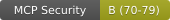

# MCP Security Badges

Add a security badge to your README to show your MCP server's security rating.

## Getting Your Badge

1. Scan your server: `npx @correctover/mcp-scanner scan https://your-mcp-server.com`
2. Get your badge code from the scan results
3. Add it to your README.md

## Badge Examples

### Static Badges (by score range)

```markdown





```

### Dynamic Badge (Cloudflare Worker)

```markdown

```

The dynamic badge automatically updates when you rescan your server.

## Badge Styles

Badges follow the same color scheme as SSL certificates and security ratings:
- **A+ (90-100)**: Green (#4c1)
- **A (80-89)**: Green (#97ca00)
- **B (70-79)**: Yellow (#a4a61d)
- **C (60-69)**: Orange (#dfb317)
- **D (50-59)**: Red (#fe7d37)
- **F (0-49)**: Dark Red (#e05d44)

## Linking to Leaderboard

Add this to your badge to link to the public leaderboard:

```markdown
[](https://0661cbb6.correctover-web.pages.dev/leaderboard.html)
```
